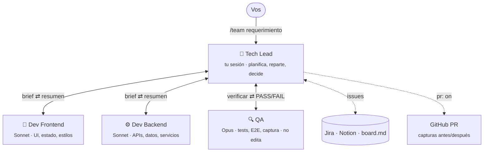
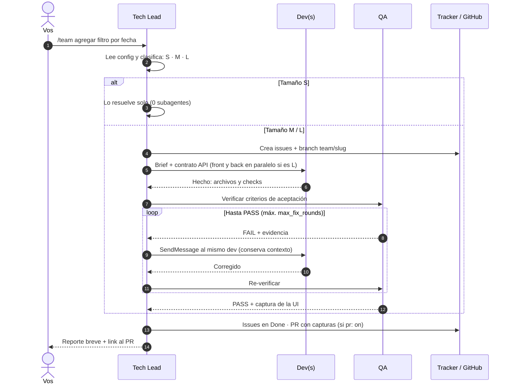

# software-team

**Un equipo de desarrollo de agentes para Claude Code, con el costo bajo control.**

Un **Tech Lead** recibe tu requerimiento, decide qué tamaño de equipo necesita y coordina a un **Dev Frontend**, un **Dev Backend** y un **QA**. No se cierra nada sin que QA lo apruebe. Las tareas se sincronizan con **Jira**, **Notion** o un **board local**, y al terminar se puede abrir un **PR con capturas antes/después**.

A diferencia de Agent Teams, donde cada teammate es una sesión completa, acá el Tech Lead es tu sesión y los demás son subagentes efímeros con contexto mínimo.

## El equipo



Los modelos y el effort de cada rol se configuran por proyecto, así que se adaptan a tu plan.

## Cómo funciona



### Tamaño según el requerimiento

| Tamaño | Cuándo | Quién trabaja |
|---|---|---|
| **S** | Cambio chico, una sola capa | Solo el Tech Lead (0 subagentes) |
| **M** | Feature en una capa, o chica en ambas | 1 Dev + QA |
| **L** | Trabajo grande en front y back | Dev Front y Dev Back en paralelo + QA |

## Instalación

```bash
/plugin marketplace add GonzaGomezDev/claude-software-agents
/plugin install software-team@software-team
```

Desarrollo local: `claude --plugin-dir /ruta/a/claude-software-agents`.

**Requisitos:**
- **Claude Code y Node** (para el hook y Playwright).
- **Opcionales:**
  - **Chrome**, para las capturas.
  - **[GitHub CLI](https://cli.github.com/) 2.99 o superior**, para PRs con imágenes.
  - **MCP de Atlassian o Notion**, si vas a usar esos trackers.

## Uso

```bash
/team setup                      # una vez por proyecto: crea .team/config.md
/team agregar login con Google   # corre el equipo

/team on                         # modo equipo por defecto en este proyecto (persiste)
/team off                        # vuelve al comportamiento normal

# opcional: fija al Tech Lead en Opus con effort high para toda la sesión
claude --agent software-team:tech-lead
```

Mientras el modo equipo está activo, cualquier pedido que cambie código pasa por el Tech Lead sin escribir `/team`.

## Cómo ahorra tokens

| Palanca | Qué hace |
|---|---|
| El TL es tu sesión | No hay una sesión extra de coordinador. Los subagentes no pueden anidar, así que el TL es el hub. |
| Tamaño S/M/L | Las tareas chicas no lanzan subagentes. |
| Briefs en disco | Cada dev recibe solo `.team/tasks/T<n>.md`, nunca la conversación. |
| `SendMessage` en los fixes | El dev que falló sigue con su contexto y no vuelve a leer el repo. |
| Reportes de ≤10 líneas | El contexto del TL no se infla. |
| Tools mínimas por agente | Menos schemas por llamada. QA no puede editar. |
| Modelos por rol | Los devs usan Sonnet (barato). QA usa Opus para la rigurosidad. |
| Capturas por CLI | Playwright con tu Chrome: 0 tokens para capturar y ~1.4k para que QA la mire. |

## Capturas y PRs

| Paso | Cómo | Tokens |
|---|---|---|
| Captura antes y después | Playwright CLI con el Chrome instalado (`--channel chrome`) | 0 |
| QA revisa la UI | lee una imagen de 1280×800 | ~1.4k |
| Imagen en el PR | `gh pr create --attach` | 0 |

La captura que QA aprueba es la misma que va al PR, así que no se captura dos veces. El browser MCP (5–20k tokens por flujo) se usa solo como fallback cuando la CLI no alcanza.

## Configuración (`.team/config.md`)

| Clave | Default | Notas |
|---|---|---|
| `tracker` | `ask` | `jira`, `notion`, `chat` |
| `dev_split` | `auto` | `fullstack` (un dev, lo más barato), `front-back` (siempre separa), `auto` (separa solo en L) |
| `dev_model` / `dev_effort` | `sonnet` / `high` | `inherit` (el modelo de tu sesión), `opus`, `sonnet` o `haiku`, según tu plan |
| `qa_model` / `qa_effort` | `opus` / `medium` | mismas opciones. Con `sonnet`, conviene effort `high` |
| `max_fix_rounds` | `3` | rondas de QA→fix antes de escalarte |
| `frontend_skills` | — | skills que el dev front carga antes de tocar UI (ej. `frontend-design:frontend-design`). `/team setup` los detecta solo |
| `ui_url` | — | URL local de la app. QA saca una captura y revisa la UI visualmente |
| `ui_auth` | — | sesión de Playwright para páginas con login. Se genera una vez: `npx playwright codegen --channel chrome --save-storage .team/auth.json <ui_url>` |
| `pr` | `off` | `on`: cuando QA aprueba, el TL commitea en `team/<slug>`, pushea y abre el PR listo para revisar, con capturas |
| `pr_base` | — | branch base del PR (vacío = el default del repo) |

**¿Separar front y back sale más caro?** Tener dos especialistas no cuesta más que uno solo. El extra viene de que cada dev explora el repo por su cuenta y del contrato API entre ellos. A cambio ganás paralelismo y briefs más enfocados. Para medirlo, corré el mismo requerimiento con `fullstack` y con `front-back` y compará con `/cost`.

## Estructura del plugin

```
.claude-plugin/          plugin.json + marketplace.json
agents/                  tech-lead · dev-frontend · dev-backend · qa
skills/team/             SKILL.md (playbook del TL) · trackers.md · config.template.md
hooks/                   team-mode.js (/team on|off)
```

## Limitaciones

- Los devs no se hablan entre sí: el TL lleva el contrato API de uno al otro.
- Si dos briefs tocan los mismos archivos, el TL usa worktrees y mergea antes de QA.
- Con `/team` en una sesión normal, el modelo del TL es el de esa sesión. Para fijarlo, usá `--agent software-team:tech-lead`.
- Los PRs con imágenes funcionan solo en GitHub.com y Enterprise Cloud (`gh --attach`).

## Licencia

[MIT](LICENSE) © Gonzalo Gomez
